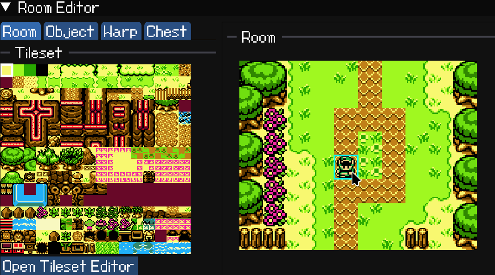

# Quickstart
Before launching the emulator, press F4 to toggle quickstart. A Link icon will appear on-screen, which can be dragged to his desired spawn position. When the emulator is launched (F5), it will automatically load file slot 1 in that room.

Unlike most other debugging functionality, this also works with external emulators, but the ROM must be reassemled each time in order to update the spawn position.
