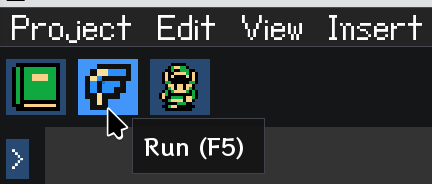
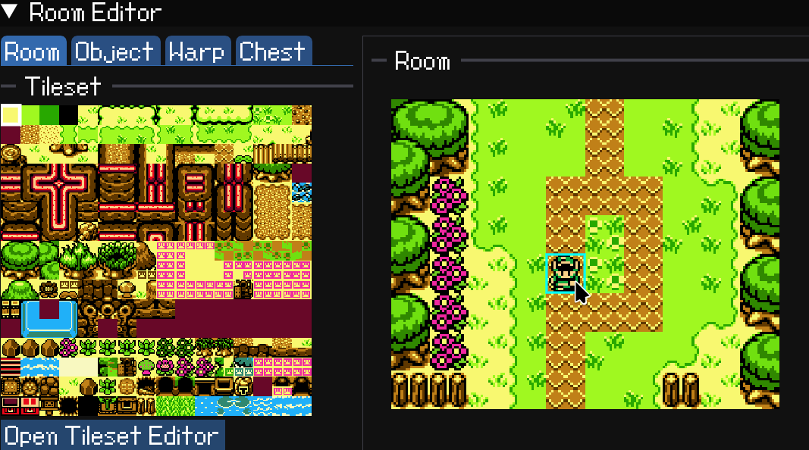
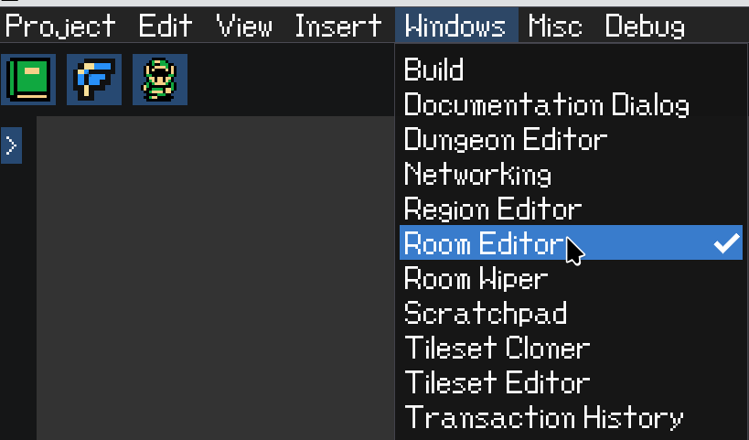
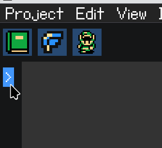
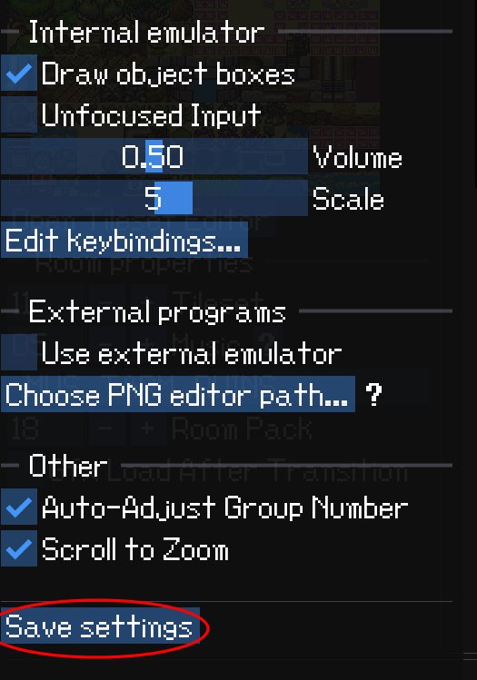

# LynnaLab Basics
## Opening a project
On Windows, LynnaLab automatically tries to open an oracles-disasm project located at C:\msys64\home\{username}\oracles-disasm. This is where the setup scripts download it to. If you followed the standard setup guides, this should already be open!

On Mac or Linux (or to open a project in a different location), navigate to Project -> Open and select the location of your oracles-disasm directory.

## Assembling & running a project
Click the "run" button or press F5 to assemble and run a project. On Windows, this requires MSYS2 and other dependencies installed by the setup scripts. For other platforms, see [Wiki: LynnaLab Setup](https://wiki.zeldahacking.net/oracle/LynnaLab#Setup).

Click the link icon right next to this in order to enable quickstart. A Link icon will appear in the room editor, and when you run the game, Link will automatically spawn into that room.

Quickstart uses whatever save data is in file slot 1. If there is no existing file, the HUD will look glitched!

## Basic usage
By default, the [Room Editor](RoomEditor.md) window is shown, which is the most fundamental interface in LynnaLab.

To access other functionality (dungeon editing, etc), use the "windows" option in the main menu bar to open more windows. Windows with a checkbox are the ones currently being shown.

Access LynnaLab's settings menu by clicking on the arrow on the left side of the screen.

Changes to LynnaLab's settings generally do not persist unless you click the "Save settings" button.

