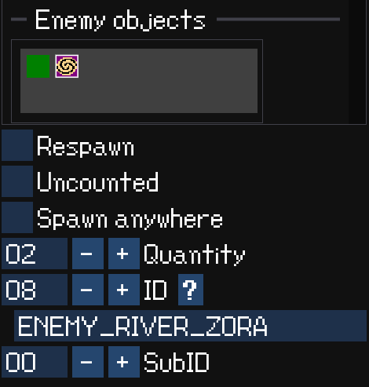

# Room Editor: Objects
## Controls
  * Left-click on an object (inside the box or in the room preview) to show its properties.
  * Right-click on an object for a context menu.
  * Right-click on an empty space in one of the object boxes to add a new object.
  * Click and drag an object within a box to reorder it. (This can matter for conditional objects.)

## Object boxes
Objects are arranged into four "boxes":

  * Main objects: Most non-enemy objects go here.
  * Enemy objects: Enemy objects go here. The difference is these won't spawn when Maple appears.
  * Before Event: Only appears when [room flag](https://wiki.zeldahacking.net/oracle/Room_flags) bit 7 is unset. Often used by bosses. Disappears with Maple.
  * After Event: Only appears when room flag bit 7 is set. Used rarely by some special events. Disappears with Maple.

There can be a fifth box, for "shared data", in a few specific rooms which reference the same data. I recommend clicking the "collapse" button so that each room's data is fully unique to that room (you don't want one room's edits to affect another).

## Object data

When you select an object, some data will be available to modify based on what type of object it is.

See [Wiki: objects](https://wiki.zeldahacking.net/oracle/Objects) for some information on how objects work.

Object types:

  * Interactions
  * Enemies (specific or random position)

The following fields are common between object types:

  * ID: Determines what it is. The object type (ie. interaction) + the ID combine 
  * SubID: The object variant. Sometimes this does nothing.
  * Var03: Like subid this can modify the object's behaviour, but usually this does nothing.

Enemies can have the following additional fields:

  * Respawn: If checked, the enemy always respawns when the screen is entered. Otherwise, killed enemies are remembered across the last 8 visited rooms (see wEnemiesKilledList).
  * Uncounted: If checked, this enemy does not increase wNumEnemies when spawned (affects puzzles). However this has NO effect on whether killing the enemy decrements wNumEnemies, so in practice this checkbox only works properly on some specific enemies (ie. sparks) which are not coded to decrement wNumEnemies on death.
  * Quantity: For random position enemies only, determines how many of the enemy to spawn.

## More documentation

Some objects have additional documentation sourced from the disassembly, ie. explaining what the subid does. Right-click on the object and click "info" to see this documentation.
