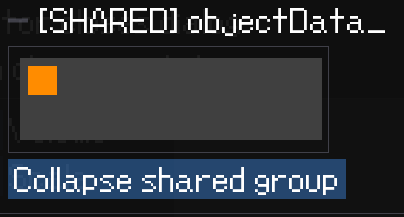

# Room Editor: Objects
## Controls
  * Left-click on an object (inside the box or in the room preview) to show its properties.
  * Right-click on an object for a context menu.
  * Right-click on an empty space in one of the object boxes to add a new object.
  * Click and drag an object within a box to reorder it. (This can matter for conditional objects.)

## Object boxes
Objects are arranged into four "boxes":

  * Main objects: Most non-enemy objects go here.
  * Enemy objects: Enemy objects go here. The difference is these won't spawn when Maple appears.
  * Before Event: Only appears when [room flag](https://wiki.zeldahacking.net/oracle/Room_flags) bit 7 is unset. Often used by bosses. Disappears with Maple.
  * After Event: Only appears when room flag bit 7 is set. Used rarely by some special events. Disappears with Maple.

There can be a fifth box, for "shared data", in a few specific rooms which reference the same data. I recommend clicking the "collapse" button so that each room's data is fully unique to that room (you don't want one room's edits to affect another).

TODO: object types
TODO: Uncounted

## 
