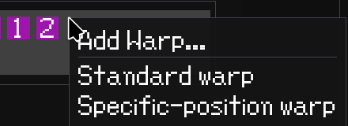
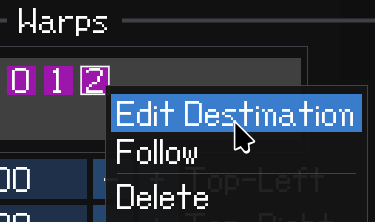
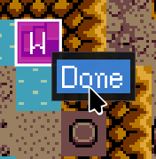

# Room Editor: Warps
## Controls
  * Select a warp to show the fields for that warp (source & destination parameters).
  * Right-click in an empty space to add new warps.

## Editing warp destinations
You can edit the destination fields directly, but it's better to right-click on the warp and select "Edit Destination".

This enters Warp Destination Edit mode. A "W" will appear in the room editor which can be moved around; it will even follow you to other rooms. This represents the destination of the warp you selected.

To exit this mode, right-click the W and select "Done".

## Warp types
  * Standard warp: If one of the top-left, top-right, bottom-left, or bottom-right flags is set, this triggers when Link exits the screen in that direction. Otherwise, the warp applies to every warp tile on the screen (ie. doors).
  * Specific-position warps: Use if there are multiple warp tiles on the screen. Unlike standard warps these can be placed on a specific tile.
    * Specific-position warps MUST come before any non-edge standard warps, otherwise the standard warp takes precedence!

## For more information
[Wiki: Warp Editing](https://wiki.zeldahacking.net/oracle/LynnaLab/Warp_editing)
